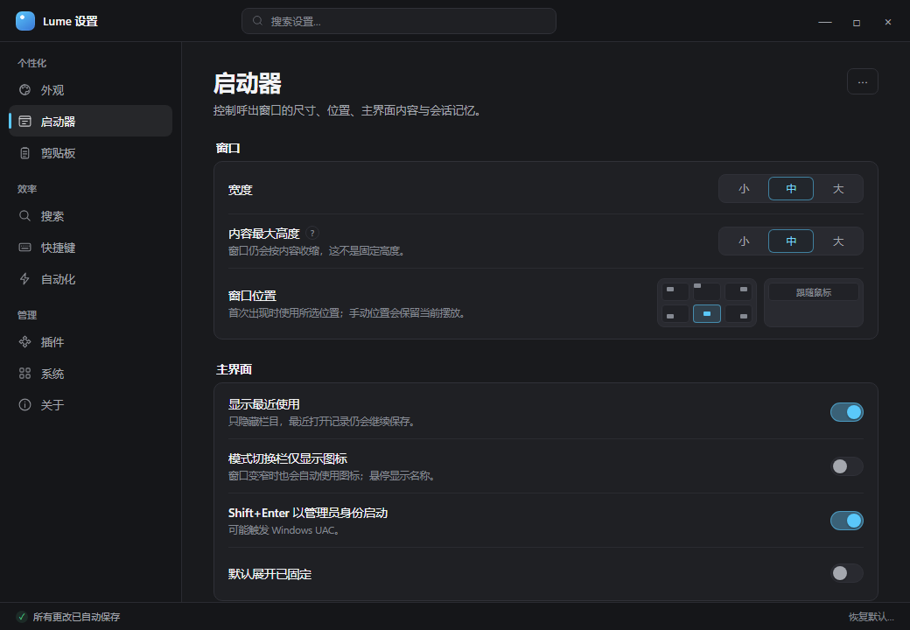
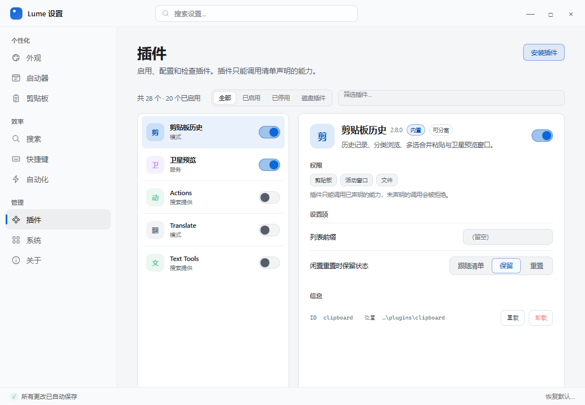

# Lume 设置面板重设计：Quiet Control Deck

适用范围：设置窗口（`src/settings/`、Tauri `settings` webview）的视觉、信息架构和交互。

设计基准：`9156224`（2026-10-18）。本文以现有功能、`settings.toml` 字段和
Rust 命令能力为边界；重设计不得改变设置语义，也不扩大插件权限或系统集成能力。

本文定义的 **Quiet Control Deck** 是设置窗默认皮肤，并定义两套皮肤共享的
信息架构、字段映射、保存模型、搜索与帮助语义。可选皮肤
[Chromatic Edge](SETTINGS_REDESIGN_SELECTED.md) 通过
`appearance.settings_skin` 切换，运行时契约见
[设置窗皮肤切换](SETTINGS_SKIN_SWITCH.md)。

文档职责：

- 本文：Quiet Control Deck 默认皮肤 + 共享功能与交互契约。
- [SETTINGS_REDESIGN_SELECTED.md](SETTINGS_REDESIGN_SELECTED.md)：Chromatic
  Edge 可选皮肤、直角构图和最终色板。
- [SETTINGS_SKIN_SWITCH.md](SETTINGS_SKIN_SWITCH.md)：皮肤字段、默认值
  `quiet`、首帧应用、保存回滚与切换验收。
- [SETTINGS.md](SETTINGS.md)：当前功能契约；设计落地前仍以其字段语义为准。

## 设计摘要

目标不是把现有卡片“换一层皮”，而是把设置窗口从“把所有选项排进同一张表单”
改造成一套有明确行为模型的控制台：

- **安静**：减少彩色标题、重复边框、常驻徽章和长段说明，让标签、当前值和状态
  成为画面的主体。
- **可理解**：把设置按用户任务重新分组；尺寸、位置、主题等选项增加可视化反馈；
  复杂规则使用自然语言摘要。
- **连贯**：可逆偏好统一自动保存并支持撤销；需要 UAC、导入或覆盖数据的操作
  单独呈现，不再与普通开关共用一套“保存 / 立即生效”语义。
- **可查**：设置搜索从真实字段目录构建，结果定位到具体设置行，而不是显示整张
  分区卡片。
- **说明分层**：默认只显示一句影响说明；完整解释、例外和技术背景按需展开，
  并参与搜索。

视觉方向暂称 **Quiet Control Deck（安静的控制台）**：两块中性表面、克制的主色、
稳定的左栏、宽松但紧凑的行距、只在选择和焦点上使用强调色。它接近 Windows 11
设置的任务化分组、macOS 设置的分栏稳定性，以及 Raycast / Linear 的即时保存与
命令搜索，但保留 Lume 轻量、键盘优先的气质。

## 现状诊断

当前设置窗口已经具备完整功能和较扎实的可访问性基础：最小尺寸可达、焦点可见、
确认框有焦点圈定、错误统一本地化、搜索能命中插件声明式设置、保存使用最小
差异 patch。重设计应保留这些契约，重点处理结构性问题。

| 问题 | 现状表现 | 用户代价 | 设计回应 |
|---|---|---|---|
| 一级导航是九个等权条目 | “外观”和“系统”与任意一个分区看起来同等重要，缺少任务分组 | 扫视成本高，难以建立整体地图 | 左栏分为个性化 / 效率 / 管理三组 |
| 页面密度极端不均 | 外观页只有两行；自动化与剪贴板页接近整屏，插件页又使用另一套卡片语言 | 页面像不同的产品拼在一起 | 统一页面标题、组、行和控件语法；复杂编辑器改为专用组件 |
| 强调色使用过多 | 分区标题、子标题、选中 chip、开关、主按钮都争夺注意力 | 画面显得像多套控件叠加 | 主色只用于选择、焦点、链接和值；组标题改为中性色 |
| 卡片内再套说明与操作 | 卡片里直接堆 `settings-hint`、错误、状态和列表编辑器 | 长说明破坏行距，页面越用越长 | 一句摘要 + 可展开详情；复杂内容进入专用编辑器 |
| 两种提交模型并存 | 底部“保存并应用”与“立即生效”徽章同时出现 | 用户无法预判关闭、丢弃和撤销的范围 | 可逆偏好自动保存并撤销；系统操作显式执行 |
| 搜索以分区为单位 | 搜索后把多个完整分区堆叠显示 | 命中结果被大量无关内容淹没 | 命令式搜索结果，逐行定位并高亮 |
| 复杂编辑器和普通行同构 | 自动化规则是六列密集行，用户索引是多控件一行，插件是手风琴卡片 | 在 560px 最小窗口下拥挤，扫视困难 | 规则卡、索引列表、插件主从视图分别设计 |
| 缺少“我改了什么”的反馈 | 修改前值、当前值、默认值缺少稳定的视觉提示 | 难以确认改动是否生效 | 自动保存状态、已修改标记、单项恢复默认 |
| 页脚占据高注意力 | 长说明和保存按钮固定在底部，且说明会被截断 | 内容区变短，底部像另一个导航栏 | 改为轻量状态栏，操作移到对应页面 |

### 保留的基础

- 独立无边框窗口、自绘标题栏和原生窗口控制。
- 深浅主题、共享主题 token、原生字体与键盘优先。
- 最小差异 patch、`settings-applied` 事件和并发轻写保护。
- 现有 Rust 校验、本地化错误和焦点陷阱。

## 参考与取舍

| 参考 | 吸收的做法 | 不照搬的部分 |
|---|---|---|
| macOS System Settings | 稳定分栏、页面切换不改变窗口结构、最近访问页 | 过强的分组卡片和系统专属尺寸，不适合 Windows 高密度设置 |
| Windows 11 Settings | 任务化分组、行内状态、系统操作与普通偏好分开 | 首页推荐卡和账户体系对便携启动器没有意义 |
| Raycast / Linear | 搜索优先、即时保存、轻量撤销、键盘路径可预测 | 不引入命令面板式的一切皆命令，设置仍需可浏览 |
| VS Code Settings | 配置项可搜索、结果可定位到字段 | 不呈现原始 JSON、不暴露技术键名作为主要标签 |
| NN/g progressive disclosure | 先显示核心选项，按需展开二级说明；层级不超过两级 | 不把常用选项藏进“高级” |

参考链接见文末。

## 设计原则

1. **当前状态先于解释**：用户先看到“值是什么”，再看到“为什么”和“例外”。
2. **一个视觉问题只有一个主色**：强调色只回答“选中了哪里”和“焦点在哪里”。
3. **可逆操作用直接操作**：开关、选项、滑块、文本值改变即保存，撤销成本低。
4. **不可逆或系统级操作必须明确**：注册服务、卸载代理、导入、恢复备份、恢复默认
   不使用自动开关的外观。
5. **说明按需出现，但路径必须明显**：使用固定的说明图标或“了解更多”，不做
   悬停才能发现的帮助。
6. **复杂对象使用自己的形状**：规则、索引目录、插件和快捷键不应被压成同一种
   标签行。
7. **最小窗口是设计约束**：560×420 下仍可完成所有设置，而不是桌面尺寸的缩略。
8. **内容不靠装饰成立**：不使用渐变、玻璃、漂浮阴影或大色块制造层级。

## 信息架构

保留九个设置分区，重排为三组。`导航页` 更名为 `启动器`，因为该页同时管理窗口、
主界面内容、会话记忆和搜索占位符，“导航页”只覆盖了其中一部分。

```text
个性化
  外观
  启动器
  剪贴板

效率
  搜索
  快捷键
  自动化

管理
  插件
  系统
  关于
```

### 页面意图

| 页面 | 页面标题 | 一句话意图 | 主要任务 |
|---|---|---|---|
| 外观 | 外观 | 调整语言与明暗主题 | 选择语言、选择主题 |
| 启动器 | 启动器 | 控制启动器出现时的样子和记忆行为 | 窗口、主界面、会话、条目 |
| 剪贴板 | 剪贴板 | 管理剪贴板历史的采集与使用 | 容量、记录类型、忽略应用、显示、粘贴、预览 |
| 搜索 | 搜索 | 管理应用与文件搜索的覆盖范围 | 系统索引、用户索引、缓存维护 |
| 快捷键 | 快捷键 | 设置呼出与模式切换按键 | 呼出键、切换键、键盘速查 |
| 自动化 | 自动化 | 在程序取得焦点时自动发送按键 | 主开关、运行方式、规则列表 |
| 插件 | 插件 | 启用、配置和检查插件 | 浏览、筛选、详情、权限、声明式设置 |
| 系统 | 系统 | 管理 Windows 集成与数据 | 开机启动、服务、提权代理、数据与备份 |
| 关于 | 关于 | 查看版本和项目信息 | 版本、许可证、贡献者、主页 |

### 导航顺序

侧栏顺序按“改变外观 → 改变使用方式 → 管理扩展与环境”排列。搜索放在效率组
第一位，因为它是启动器最核心的能力；快捷键和自动化紧随其后，符合“先定义入口，
再定义自动行为”的路径。

`外观` 与 `启动器` 分开，而不是合并成一个大页面：前者是跨所有 Lume 表面的
语言和主题，后者是启动器主界面的布局与行为。两者在搜索中都能直接定位，因此
不需要为了减少一级项而牺牲概念边界。

## 窗口与整体布局

### 默认尺寸

- 默认打开尺寸：`1040 × 720`，在小于工作区时自动收敛到
  `min(1040, workArea.width - 64) × min(720, workArea.height - 64)`。
- 最小尺寸：`560 × 420`，与现状一致。
- 窗口继续可调整大小并使用现有标题栏的最大化 / 还原控制；本文不新增窗口尺寸
  设置字段。
- 设置窗口重新获得焦点且当前没有未提交的本地文本时，重读最新设置；正在编辑的
  控件不被外部轻写覆盖。

### 主布局

```text
┌────────────────────────────────────────────────────────────────────────┐
│ Lume 设置                    [⌕ 搜索设置…              ]      ─  □  ×  │ 48
├────────────────┬───────────────────────────────────────────────────────┤
│ 个性化         │  启动器                                        [⋯]     │
│  ◉ 外观        │  控制窗口尺寸、主界面内容与会话记忆。                   │
│  ○ 启动器      │                                                       │
│  ○ 剪贴板      │  窗口                                                  │
│                │  ┌───────────────────────────────────────────────────┐  │
│ 效率           │  │ 宽度                    [小] [中] [大]             │  │
│  ○ 搜索        │  │ 内容最大高度            [小] [中] [大]             │  │
│  ○ 快捷键      │  │ 窗口位置                [四角与居中缩略图]          │  │
│  ○ 自动化      │  └───────────────────────────────────────────────────┘  │
│                │                                                       │
│ 管理           │  主界面                                                │
│  ○ 插件        │  ┌───────────────────────────────────────────────────┐  │
│  ○ 系统        │  │ 显示最近使用                       [关闭]           │  │
│  ○ 关于        │  │ 只隐藏栏目，最近打开记录仍会继续保存。              │  │
│                │  └───────────────────────────────────────────────────┘  │
├────────────────┴───────────────────────────────────────────────────────┤
│ ✓ 所有更改已自动保存                                        恢复默认… │ 32
└────────────────────────────────────────────────────────────────────────┘
```

### 尺寸与节奏

| 区域 | 值 | 说明 |
|---|---:|---|
| 标题栏 | 48px | 与当前窗口 chrome 保持一致，略高于 40px 插件窗口标题栏 |
| 底栏 | 32px | 自动保存状态与恢复默认入口 |
| 侧栏宽 | 208px | ≥1000px 窗口宽度 |
| 侧栏内边距 | 12px 水平 | 导航项与边缘保持 8px 视觉留白 |
| 内容最大宽 | 760px | 单列阅读宽度，避免长行 |
| 内容水平内边距 | 40px | 内容栏居中；低于 900px 时降为 28px |
| 页面顶部留白 | 32px | 页面标题与标题栏之间 |
| 页面底部留白 | 40px | 最后一组与底栏之间 |
| 组间距离 | 28px | 组标题与上一组卡片之间 |
| 组标题与卡片 | 8px | 标题不放进卡片 |
| 卡片内边距 | 4px 16px | 行自己承担上下 12px，分隔线贴齐 |
| 普通行高 | 56–64px | 有摘要时 64px，无摘要时 56px |
| 控件间距 | 8px 横向，12px 纵向 | 不因换行改变组内对齐 |
| 圆角 | 10px 卡片 / 8px 控件 / 6px 小按钮 | 不使用胶囊作为通用容器 |

### 双平面背景

设置窗口只使用两块基础表面，不使用逐组浮起卡片：

- **导航平面**：标题栏与侧栏使用略深/略灰的导航表面。
- **内容平面**：内容区使用主表面；组卡片使用 `card` 表面和 1px 边框。
- 组卡片内部不再嵌套第二层卡片；列表编辑器、警告和状态块使用无边框色块或
  细线分隔。

建议 token（最终以 `src/theme.css` 统一提供，组件内不得写死颜色）：

| Token | 深色建议 | 浅色建议 | 用途 |
|---|---|---|---|
| `--settings-canvas` | `#191A1D` | `#F5F6F8` | 内容区底色 |
| `--settings-rail` | `#151619` | `#F9FAFB` | 标题栏与侧栏 |
| `--settings-card` | `#1F2024` | `#FFFFFF` | 组卡片 |
| `--settings-control` | `#292A30` | `#F2F3F5` | 输入框、分段控件底 |
| `--settings-border` | `#303138` | `#DDE1E6` | 卡片与控件边框 |
| `--settings-divider` | `#2A2B31` | `#ECEEF1` | 行分隔线 |
| `--settings-text` | `#F3F4F6` | `#1B1D21` | 主文本 |
| `--settings-secondary` | `#A4A7AE` | `#555D68` | 次级文本 |
| `--settings-muted` | `#858992` | `#6F7782` | 摘要、元信息 |
| `--settings-accent` | 现有 `--accent` | 现有 `--accent` | 选中、焦点、值 |
| `--settings-accent-text` | 现有 `--accent-text` | 现有 `--accent-text` | 链接与小字强调 |

主色沿用 Lume 已有品牌层级，不另造高饱和“设置专属色”。视觉变化来自使用比例，
而不是再增加一种颜色。

### 视觉预览

下面的静态预览对应本文的两种主要表面：深色启动器页与浅色插件主从视图。
预览文件与截图位于 `docs/assets/settings-redesign/`；`preview.html` 可用于在浏览器
中打开并检查布局，不是生产组件。





### 字体

| 层级 | 字号 / 行高 | 字重 | 颜色 |
|---|---|---:|---|
| 窗口标题 | 13 / 18 | 600 | secondary |
| 页面标题 | 26 / 32 | 600 | text |
| 页面说明 | 14 / 21 | 400 | secondary |
| 组标题 | 14 / 20 | 600 | text |
| 行标题 | 14 / 20 | 500 | text |
| 行摘要 | 12.5 / 18 | 400 | muted |
| 帮助正文 | 13 / 20 | 400 | secondary |
| 状态与元信息 | 12 / 17 | 500 | muted |
| 路径与快捷键 | 12 / 18 | 500 | text，等宽字体 |

字体继续使用 `"Segoe UI Variable Text", "Segoe UI", system-ui`；路径与 ID 使用
`"Cascadia Mono", "Consolas", monospace`。不使用全大写英文组标题，以免在
中文界面中产生额外噪声。

### 图标

- 侧栏图标 18px，线宽 1.5–1.75px；同一套线性图标贯穿导航、说明和动作。
- 行内动作图标 16px，放在至少 32×32px 的命中盒中。
- 状态使用小圆点、文字和形状共同表达，不只依赖颜色。
- 图标按钮必须有可访问名称；说明图标不能只在悬停时出现。

### 动效

- 控件状态变化 120ms `ease-out`。
- 说明展开 140ms，只改变高度和透明度。
- 页面切换 120ms、向上 4px 的淡入；不做横向滑动。
- 遵守 `prefers-reduced-motion: reduce`，关闭位移和淡入。

## 导航与页面头

### 侧栏

- 组标签 11.5px、500、muted，上间距 20px，首组上间距 8px。
- 导航项高 38px，图标与文字间距 10px，圆角 8px。
- 悬停使用低对比填充；当前项使用 `selected` 填充和左侧 3×18px 的强调色标记。
- 当前项文字使用主文本色，非当前项使用 secondary；图标不使用另说颜色。
- 侧栏独立滚动，但滚动条不可见；键盘焦点与当前项分离。
- 低于 760px 时折叠为 56px 图标栏；每个图标保留 `aria-label` 和原生 `title`。
- 低于 520px 高度时压缩组间距和导航项高度，不覆盖底栏。

### 页面头

每个页面由以下结构开始：

```text
页面标题                                      [页面级动作] [⋯]
一行说明，最多两行。
```

- 页面标题使用 26px；页面说明只解释该页面的共同目标，不重复行摘要。
- 页面级动作只放当前页最重要的动作，例如搜索页的“立即刷新”、插件页的“安装插件”。
- `⋯` 菜单放低频但全局相关的动作，例如“恢复本页默认值”。
- 页面头不固定在标题栏内；内容滚动时自然离开，标题栏始终保留搜索和窗口控制。

### 行结构

标准设置行：

```text
┌────────────────────────────────────────────────────────────────────┐
│ 标签  (?)                                      [控件或当前值]      │
│ 一句影响说明，最多两行。                                           │
└────────────────────────────────────────────────────────────────────┘
```

- 标签与控件是同一个设置单元，控件通过 `aria-labelledby` 关联标签。
- 有摘要时，摘要通过 `aria-describedby` 关联控件。
- 行整体可悬停高亮，但只有控件区域可点击；除整行都是可展开项的情况。
- 已修改的行在标签左侧显示 4px 强调点；默认值行不显示。
- 已修改且可恢复的行，在悬停或键盘焦点进入时显示“恢复默认”图标按钮。
- 危险操作不放在行尾的普通图标按钮里；使用带文字的按钮并置于独立操作组。

### 组

- 组由中性色标题和一张卡片组成。
- 组标题右侧允许一个说明图标或状态 chip，但不放主操作。
- 同组行之间使用 1px 分隔线；首行无上边线，末行无下边线。
- 组卡片不嵌套卡片。复杂编辑器可以占据整行，但编辑器内部的列表项只使用
  细线和弱底色。
- 依赖关闭时，子控件保持可见但禁用，并在行摘要中说明依赖；这样既保留搜索
  可发现性，也避免不可解释的隐藏。

## 控件规范

### 开关

- 视觉尺寸 38×22px，触控命中盒至少 44×36px。
- 开启时使用强调色填充；关闭时使用控制底色和边框，不使用纯白滑块。
- 开关的可见标签就是整行标题；不能再依赖行内重复文字。
- 保存失败时回到原状态，并在行下方显示一次错误，不重复弹多个 toast。

### 分段选择

- 用于 2–4 个互斥选项，例如主题、时间显示、宽高档位。
- 高 32px，圆角 8px，容器底为 `control`，选中段为 `card` + 边框 + 强调色文字。
- 选中段必须有 `aria-pressed` 或 radio 语义；键盘左右箭头切换，Home/End 到首尾。
- 超过 4 个选项时使用下拉或可滚动的选项面板，不把页面撑成密集 chip 墙。

### 数值与滑块

- 数值设置同时显示可编辑数值和单位，滑块只用于连续范围。
- 拖动时实时更新预览，但保存使用 200ms 合并或指针释放时提交。
- 输入框接受精确值；失焦或 Enter 时归一化，非法值显示行内错误。
- 预设值与自定义值共存时，预设作为快捷按钮，自定义入口始终可见。

### 文本输入

- 单行输入高 34px，圆角 8px。
- 输入过程中不写盘；停止输入 500ms、失焦或 Enter 时提交。关闭窗口前刷新待提交值。
- 空字符串是否代表默认值必须在行摘要中说明。
- 文本选择、复制、粘贴和 IME 行为保持原生；不拦截系统编辑快捷键。

### 快捷键录制

- 显示为大号 keycap 组合，例如 `Alt` + `Space`，而不是普通文本框。
- 点击“更改”后进入录制态；显示“按下新的组合键…”和 Esc 取消提示。
- 录制控件必须有明确焦点环；失焦、点击外部和 Esc 都取消，并递增请求序号。
- 呼出键和切换模式键继续使用不同的校验路径；切换键允许单键。
- 录制成功后自动保存，并在下方显示当前注册状态或冲突原因。

### 文件夹选择

- 路径输入与“选择文件夹”并列。
- 选中或输入后先校验存在性、目录类型、可读性和重复项，再写入。
- 无效路径保留用户在输入框中的原始文本，显示行内错误，不静默丢弃。
- 已保存但失效的目录行显示修复按钮和错误摘要。

### 列表与规则编辑器

- 简单列表（用户索引、忽略应用）使用 44–52px 行高，末尾“添加”按钮展开内联编辑器。
- 复杂规则（自动化）使用卡片：折叠态是一句自然语言摘要，展开态才显示完整控件。
- 空态使用一句说明和一个主动作，不使用大面积插画占位。
- 删除、卸载、恢复备份等不可逆动作使用带文字的确认对话框；不使用按钮文字突然
  变成“再次点击确认”的双击模式。

### 状态条与提示

- 全局自动保存状态固定放在底栏左侧，高度 32px，文案不超过一行。
- 行内错误放在对应控件下方，使用 `role="alert"`；不在底部再弹同义 toast。
- 成功状态使用 `role="status"`，默认 2 秒后淡出；撤销入口保留 6 秒。
- 系统操作进行中显示在对应状态卡内，按钮进入忙碌态，不阻塞其它设置。

## 提交模型

### 决策

设置窗口统一为 **可逆偏好自动保存**，不再提供全局“保存并应用”。

这不是把系统操作也自动执行，而是把界面拆成两类：

| 类型 | 例子 | 行为 |
|---|---|---|
| 可逆偏好 | 主题、语言、窗口尺寸、剪贴板开关、搜索目录、快捷键、自动化规则、插件启停、插件声明式设置 | 编辑即预览，自动保存；失败回滚；可撤销最近一次操作 |
| 系统操作 | 注册 / 卸载服务、注册 / 卸载提权代理、导入设置、恢复备份、恢复默认、卸载插件 | 明确按钮或确认对话框；显示进度和真实结果；不提供泛化“撤销” |

### 保存生命周期

```text
用户编辑
  → 本地校验 / 归一化
  → 乐观更新预览
  → 合并队列（同一字段只保留最后值）
  → save_settings_patch
      ├─ 成功：更新基线，底栏显示“已保存”，提供 6 秒撤销
      └─ 失败：恢复上一个有效值，行内显示错误，底栏提供重试
```

实现约束：

- 同一时间只允许一个写请求在途；同一字段的多次输入合并为最后一次。
- 不同字段的写入按顺序完成，前端使用请求序号丢弃过期响应。
- 失败不得让后续排队写入覆盖失败值；当前字段恢复到最近一次已确认值。
- `settings-applied` 到达时，非焦点行和只读状态刷新；正在编辑的文本输入保留
  本地草稿，避免外部轻写打断输入。
- 自动保存需要避免每次按键都覆盖 `backup.toml`。建议用编辑会话或短时间合并
  窗口保留“本次编辑开始前的快照”，系统操作仍然在执行前独立快照。

### 提交时机

| 控件 | 预览 | 持久化 |
|---|---|---|
| 开关、分段选择 | 立即 | 立即，失败回滚 |
| 单行文本 | 立即显示 | 停止输入 500ms、失焦或 Enter |
| 滑块 | 拖动中实时 | 指针释放，或 200ms 合并后 |
| 数字输入 | 输入中保留原文 | 失焦或 Enter 校验后 |
| 快捷键录制 | 录制界面 | 校验通过后立即 |
| 列表增删 | 立即 | 一个完整操作完成后 |
| 插件启停 / 插件设置 | 立即 | 立即 |
| 服务 / 代理 / 导入 / 恢复 | 状态卡内显示进度 | 显式操作命令 |

### 关闭窗口

- 没有待提交且未失败的本地编辑时，直接关闭，不再询问“是否保存”。
- 仍有待提交文本或滑块值时，先刷新保存队列，再关闭。
- 保存失败时保留窗口，底栏显示“设置未保存 · 重试”，并保留失败行的焦点。
- 系统操作进行中关闭窗口时，提示“操作仍在进行，关闭窗口不会取消”，由用户决定。

### 撤销与恢复

- 最近一次可逆偏好变化通过底栏 snackbar 提供“撤销”，覆盖一次完整操作，
  包括一组列表变更或一次快捷键替换。
- 行内“恢复默认”只恢复该字段；修改后出现，默认值不显示。
- 页面级“恢复本页默认值”放在页面 `⋯` 菜单，执行前使用确认面板。
- “恢复应用默认值”继续只覆盖外观、启动器、剪贴板、快捷键、搜索和自动化，
  不改插件和系统集成；确认文案必须明确这一范围。
- 导入、恢复备份和插件卸载不承诺撤销，必须展示替换/删除范围。

## 设置搜索

### 形态

搜索框固定在标题栏中部，默认宽 360px；输入后打开结果浮层，而不是过滤侧栏并
堆叠整页内容。

```text
┌ 搜索设置… ────────────────────────────────────────────────┐
│ 窗口位置                                   启动器 › 窗口  │
│ 跟随鼠标 · 每次呼出定位到光标                             │
│────────────────────────────────────────────────────────────│
│ 合并窗口                                   剪贴板 › 合并复制│
│ 1.5 秒                                                    │
│────────────────────────────────────────────────────────────│
│ 提权代理                                   系统 › 后台组件 │
│ 需要管理员权限                                            │
└────────────────────────────────────────────────────────────┘
```

### 结果规则

- 结果一行一个设置，显示字段标题、所在页面和路径、当前值或一句摘要。
- 排序优先级：标题精确匹配 → 标题前缀 → 关键词 → 摘要 → 详情 → 页面名称。
- 命中词在标题与摘要中高亮；不把整段帮助文本塞进结果行。
- 插件名称、插件描述、插件声明式设置标签、选项值和权限说明参与索引。
- 搜索目录、路径、快捷键、ID 等可复制值同时支持原文匹配。
- 设置动作也进入目录，但点击结果只负责跳转，不直接执行系统操作。
- 无结果时显示“没有匹配的设置”，并给出可点击的建议词，例如“主题、窗口、
  快捷键、索引”。

### 跳转

- 鼠标点击或 Enter 跳转到对应页面。
- 目标行滚动到视口中央并显示 1.6 秒的强调描边；焦点落在行容器而不是开关本身，
  避免用户继续按 Enter 时误改值。
- 目标行有展开式详情时，跳转不自动展开，避免页面高度突跳；只高亮标题。
- `Esc` 关闭结果浮层并清空查询；`ArrowUp` / `ArrowDown` 移动；`Ctrl+F` 聚焦搜索。
- 搜索输入使用 combobox 语义：`aria-controls` 指向结果 listbox，
  `aria-activedescendant` 指向当前结果，结果项提供可读的页面路径和当前值。

### 索引来源

搜索索引必须从一个共享的 `SETTINGS_CATALOG` 构建，而不是维护
`SECTION_SEARCH_KEYS` 与页面文案两份清单。每个目录项至少包含：

```ts
type SettingDescriptor = {
  id: string;                 // 稳定字段 ID，如 "appearance.window_position"
  section: SectionId;
  path: string;               // 显示路径，如 "启动器 › 窗口"
  label: string;              // 本地化标题
  summary?: string;           // 默认可见的一句说明
  details?: string[];         // 按需展开的说明
  keywords: string[];         // 同义词、技术术语、英文键名
  kind: "switch" | "segmented" | "number" | "text" | "editor" | "action";
  value: string;              // 当前值的可读表示
};
```

目录是页面渲染、搜索和自动化断言共用的唯一描述来源。新增设置时，缺目录项、
缺三语文案或缺帮助内容会直接暴露，而不是等到用户搜索不到才发现。

## 帮助系统

### 三层信息

1. **页面说明**：只说明该页共同目标，1–2 行。
2. **行摘要**：默认可见，描述设置的真实影响，避免重复标签；只在需要时出现，
   最多两行。
3. **展开详情**：用户点击说明图标后显示，包含生效时机、例外、依赖和示例。

说明图标使用 14px 的低对比 `?` 或信息符号，放在标签后；只有存在详情时出现。
点击后展开为行下方的内联面板，不覆盖内容、不依赖悬停，也便于键盘和读屏使用。
同一页面允许一个说明面板展开；打开另一个时前一个收起。

### 详情结构

详情不是一个长段落，而是最多四个短块：

```text
什么时候生效      重启后 / 仅本次运行 / 立即
影响什么          例如：只隐藏栏目，不停止记录
例外与依赖        例如：需要先启用某个开关
示例              例如：kuake / kk → 夸克
```

不是每条设置都需要四个块。简单设置不需要说明图标；有技术背景的设置（例如
UIPI、索引缓存、闲置重置）才使用完整详情。

### 文案风格

- 使用用户结果描述，而不是实现机制：“关闭后窗口会自动收缩”而不是“高度由
  fit policy 决定”。
- 先讲默认行为，再讲开启后的变化。
- 用“重启后”“本次运行”“立即”“需要管理员”明确生效范围。
- 技术名词只在不可替代时出现；第一次出现时用一句话解释。
- 避免把按钮名写进说明来代替解释。
- 摘要建议 18–42 个中文字符；详情每个块 1–3 句。
- 三语保持相同的结构，不要求逐字互译。

### 改写示例

| 位置 | 现有长说明 | 新摘要 | 展开详情 |
|---|---|---|---|
| 各模式独立搜索词 | 一整段解释共享单值与模式切换 | 关闭时所有模式共用搜索框内容；开启后分别记住。 | 仅本次运行有效；进入插件时的关键词不会被当作搜索词。 |
| 闲置重置 | 同时解释隐藏阈值、清空搜索、插件豁免和分离窗口 | 隐藏超过设定时间后，下次呼出回到干净状态。 | 会清除查询并重置未豁免的插件页面；豁免页面保留状态。分离窗口不参与重置。 |
| 提权代理 | 解释 UIPI、计划任务和能力边界 | 用于向以管理员运行的程序发送自动快捷键。 | 注册需要一次管理员授权；代理只能向指定前台窗口发送一次已配置的快捷键。 |
| 自动动作 | 介绍触发条件、新窗口、Alt+Tab 和后台启动 | 程序的新窗口获得焦点时，发送一次快捷键。 | 已运行的实例被 Alt+Tab 切回不会重复触发；后台或最小化启动不保证触发。 |

### 帮助与搜索

摘要和详情都进入搜索索引；搜索命中的行可直接跳转，详情本身不复制进搜索结果。
这样用户可以搜索“只隐藏栏目”“UIPI”或“重启后”，同时保持结果列表干净。

## 页面设计

### 外观

页面说明：选择 Lume 的界面语言与明暗主题。更改实时预览并自动保存。

#### 主题

用三张 136×76px 的主题预览卡替代单纯 chip：

```text
┌─────────────┐  ┌─────────────┐  ┌─────────────┐
│ ░░░░░░░░░░░ │  │ ▓▓▓▓▓▓▓▓▓▓▓ │  │ ░░░░░░░░░░░ │
│ ░  Lume   ░ │  │ ▓  Lume   ▓ │  │ ░  Lume   ░ │
│ ░░░░░░░░░░░ │  │ ▓▓▓▓▓▓▓▓▓▓▓ │  │ ░░░░░░░░░░░ │
│ 跟随系统    │  │ 深色        │  │ 浅色        │
└─────────────┘  └─────────────┘  └─────────────┘
```

- 卡片内部是静态迷你表面，不承载真实交互；整卡可点击。
- 选中卡使用强调色边框和标题旁的小圆点，不只靠边框颜色。
- 主题卡下方只有一句摘要：“跟随系统会随 Windows 应用模式切换。”

#### 语言

- 使用一行分段选择：跟随系统 / English / 简体中文 / 繁體中文。
- 语言名称始终使用自身语言显示；当前语言用强调色文字，而不是给整颗 chip 填充
  大块强调色。
- 语言切换后立即更新当前窗口与托盘菜单；页面保持当前滚动位置。

#### 功能映射

| 设置键 | 控件 | 说明呈现 |
|---|---|---|
| `appearance.color_mode` | 主题预览卡 | 跟随系统摘要 + 详情 |
| `appearance.language` | 分段选择 | 简短摘要 |

### 启动器

页面说明：控制呼出窗口的尺寸、位置、主界面内容与会话记忆。

#### 组一：窗口

- **宽度**：现有三档 小 540 / 中 720 / 大 900，使用带窗口轮廓的分段选择；
  悬停显示实际像素。
- **内容最大高度**：现有三档 420 / 520 / 620，行摘要明确“窗口仍会按内容收缩，
  这不是固定高度”。
- **窗口位置**：使用 3×2 的显示器缩略网格，每个格子展示窗口落点；下方另有
  “跟随鼠标”和“手动位置”两个独立选项。
  - 选中四角或居中时，`remember_position` 关闭。
  - 选择“手动位置”时，`remember_position` 打开；首次出现也不套用预设。
  - “手动位置”的详情说明位置只在会话内继承，重启后按设置重新定位。

窗口组右侧在宽度 ≥ 900px 时显示一个静态启动器缩略图，随宽度档位改变外形；
窗口更窄时缩略图隐藏，控件本身仍可理解。

#### 组二：主界面

| 设置键 | 标签 | 摘要 |
|---|---|---|
| `appearance.show_recent` | 显示最近使用 | 只隐藏栏目，记录仍会继续保存。 |
| `appearance.show_explorer_bar` | 显示 Windows 资源管理器栏 | 在资源管理器前台时显示当前文件夹动作。 |
| `appearance.expand_pinned` | 默认展开已固定 | 启动器重新打开时保留展开状态。 |
| `appearance.mode_switch_icons_only` | 模式切换栏仅显示图标 | 窗口变窄时也会自动使用图标；悬停显示名称。 |
| `appearance.shift_enter_admin` | Shift+Enter 以管理员身份启动 | 可能触发 Windows UAC。 |

简单开关不显示说明图标；只有“显示最近使用”“模式切换栏仅显示图标”和
“Shift+Enter 管理员启动”有摘要。

#### 组三：会话与搜索

| 设置键 | 控件 | 摘要与依赖 |
|---|---|---|
| `appearance.remember_last_page` | 开关 | 重启后回到上次页面；搜索词不写入磁盘。 |
| `appearance.per_mode_query` | 开关 | 关闭时共享；开启后每个模式分别记忆。 |
| `appearance.idle_reset_enabled` | 开关 | 隐藏超过阈值后，下次呼出回到干净状态。 |
| `appearance.idle_reset_minutes` | 预设 + 自定义 | 关闭闲置重置时保持可见但禁用。 |
| `appearance.recent_count` | 预设 + 自定义 | 5–200，默认 20。 |
| `appearance.search_placeholder_apps` | 文本输入 | 留空使用默认文案。 |
| `appearance.search_placeholder_clipboard` | 文本输入 | 留空使用默认文案。 |

“闲置重置”的详情中提供“插件页的保留状态设置”链接，点击跳转到插件页的
`keep_session` 控件。

#### 组四：条目

- **条目框大小**：70 / 110 / 150，使用三个小方块预览，而不是只有“小中大”。
- **应用图标圆形显示**：开关；摘要说明只影响条目图标，关闭时直接显示原始图标。

#### 功能映射

| 设置键 | 新位置 |
|---|---|
| `appearance.window_width` | 启动器 › 窗口 › 宽度 |
| `appearance.window_height` | 启动器 › 窗口 › 内容最大高度 |
| `appearance.window_position` | 启动器 › 窗口 › 窗口位置 |
| `appearance.remember_position` | 启动器 › 窗口 › 手动位置 |
| `appearance.show_recent` | 启动器 › 主界面 |
| `appearance.show_explorer_bar` | 启动器 › 主界面 |
| `appearance.expand_pinned` | 启动器 › 主界面 |
| `appearance.mode_switch_icons_only` | 启动器 › 主界面 |
| `appearance.shift_enter_admin` | 启动器 › 主界面 |
| `appearance.remember_last_page` | 启动器 › 会话与搜索 |
| `appearance.per_mode_query` | 启动器 › 会话与搜索 |
| `appearance.idle_reset_enabled` | 启动器 › 会话与搜索 |
| `appearance.idle_reset_minutes` | 启动器 › 会话与搜索 |
| `appearance.recent_count` | 启动器 › 会话与搜索 |
| `appearance.search_placeholder_apps` | 启动器 › 会话与搜索 |
| `appearance.search_placeholder_clipboard` | 启动器 › 会话与搜索 |
| `appearance.entry_size` | 启动器 › 条目 |
| `appearance.round_app_icons` | 启动器 › 条目 |

### 剪贴板

页面说明：管理剪贴板历史的采集、显示、粘贴与预览方式。

如果内置剪贴板页面处于停用状态，页面顶部显示一条信息条：
“剪贴板页面已停用，但后台采集仍遵循本页开关。”并提供跳转到插件页的动作。
这条信息不改变任何设置。

#### 组一：历史与采集

| 设置键 | 标签 | 控件 | 摘要 |
|---|---|---|---|
| `clipboard.history_cap` | 历史记录上限 | 预设 + 自定义 | 固定记录不计入上限。 |
| `clipboard.record_images` | 记录图片 | 开关 | 图片以本地缓存形式保存。 |
| `clipboard.record_files` | 记录文件 | 开关 | 文件只保存引用，不复制文件本身。 |
| `clipboard.dedup` | 内容去重 | 开关 | 整条内容相同的复制不新增记录；图片只防连续重复。 |

#### 组二：合并复制

`merge_copy` 是开关；`merge_window_ms` 是滑块 + 数值标签。关闭合并复制时
滑块保持可见但禁用，行摘要说明“开启合并复制后可设置时间窗口”。默认值为
1.5 秒，范围 0.5–5 秒。

#### 组三：忽略应用

- 默认显示已添加应用列表；每条包含应用名、来源图标和删除按钮。
- 末尾“添加应用”按钮展开一个内联编辑器：
  `[应用名或进程名] [选择运行中程序] [添加]`
- 添加前由 Rust 归一化名称并做大小写不敏感重复检查；重复或无效时留在编辑器内
  显示行内错误。
- 空态只显示一句“尚未添加忽略应用”和添加按钮。

#### 组四：显示与粘贴

| 设置键 | 标签 |
|---|---|
| `clipboard.show_source_app` | 显示来源应用 |
| `clipboard.time_display` | 时间显示方式（相对 / 绝对） |
| `clipboard.hover_select` | 悬停选中条目 |
| `clipboard.favorites_top` | 收藏的条目置顶显示 |
| `clipboard.paste_close` | 粘贴后关闭窗口 |

“时间显示方式”使用分段选择；“悬停选中”增加一句摘要：“关闭后只有点击才会
改变选中项。”

#### 组五：预览

| 设置键 | 标签 | 摘要 |
|---|---|---|
| `clipboard.preview` | 开启预览 | 关闭后不再弹出卫星预览，列表内缩略图保留。 |
| `clipboard.remember_checks` | 记住勾选 | 多文件条目的勾选状态在下次打开时恢复。 |

#### 功能映射

| 设置键 | 新位置 |
|---|---|
| `clipboard.history_cap` | 剪贴板 › 历史与采集 |
| `clipboard.record_images` | 剪贴板 › 历史与采集 |
| `clipboard.record_files` | 剪贴板 › 历史与采集 |
| `clipboard.dedup` | 剪贴板 › 历史与采集 |
| `clipboard.merge_copy` | 剪贴板 › 合并复制 |
| `clipboard.merge_window_ms` | 剪贴板 › 合并复制 |
| `clipboard.ignore_apps` | 剪贴板 › 忽略应用 |
| `clipboard.show_source_app` | 剪贴板 › 显示与粘贴 |
| `clipboard.time_display` | 剪贴板 › 显示与粘贴 |
| `clipboard.hover_select` | 剪贴板 › 显示与粘贴 |
| `clipboard.favorites_top` | 剪贴板 › 显示与粘贴 |
| `clipboard.paste_close` | 剪贴板 › 显示与粘贴 |
| `clipboard.preview` | 剪贴板 › 预览 |
| `clipboard.remember_checks` | 剪贴板 › 预览 |

### 搜索

页面说明：选择应用与文件搜索覆盖的目录，并维护可重建的索引缓存。

页面头右侧提供“立即刷新索引”动作；运行期间显示旋转图标、`aria-busy` 和
“正在刷新”，成功后只在任务真正结束后显示状态。

#### 组一：系统索引

三行开关：桌面、System32、开始菜单。每行有一个简短的索引对象说明，例如
“桌面上的可启动项和快捷方式”。开关值直接对应 `index.system_dirs`。

#### 组二：用户索引

每条索引显示为两行：

```text
工作资料    D:\Work
[索引文件 ●]                         [修复路径] [删除]
```

- 名称使用粗体，路径使用可复制、可截断的等宽字体。
- “索引文件”标签始终可见，开关对应 `no_files` 的反向值。
- 修复路径打开文件夹选择器；选择后立即校验并更新该行。
- 添加区默认收起，点击“添加索引目录”后出现名称、路径、选择文件夹和添加按钮。
- 错误显示在对应条目下方，不用全局 toast 代替。

#### 组三：索引维护

- 缓存刷新间隔使用滑块 + 数值，范围 5–1440 分钟，步进 5。
- 行摘要说明启动时始终会刷新一次，滑块控制的是之后的后台刷新间隔。
- 页面头“立即刷新索引”只重建可重建缓存；没有结果时不放置空进度条。

#### 功能映射

| 设置键 | 新位置 |
|---|---|
| `index.system_dirs` | 搜索 › 系统索引 |
| `index.user_index` | 搜索 › 用户索引 |
| `index.cache_refresh_interval_minutes` | 搜索 › 索引维护 |
| `refresh_index` | 搜索页头动作 |

### 快捷键

页面说明：设置呼出 Lume 与切换模式的按键，并查看常用键盘操作。

#### 呼出主界面

- 使用一个大号组合键卡：

```text
Alt + Space                                      [更改]
```

- 点击“更改”后进入录制态；Esc、失焦、点击其他控件都取消。
- 下方“常用组合”折叠区保留 Alt+Space / Ctrl+Space 预设。预设不是常驻 chip 墙，
  只在用户需要时展开。
- 如果 `get_hotkey` 显示当前组合未注册，显示黄色状态行：“快捷键未注册，
  可能被其他程序占用”，并引导用户重新录制一个空闲组合。

#### 切换模式

- 同样的组合键卡，默认 `Tab`。
- 摘要直接说明：单键只在搜索框聚焦时切换；`Ctrl+Tab` 可在任意焦点切换。
- 录制时继续使用独立的 `validate_mode_hotkey`，允许单键。

#### 键盘速查

页面底部放一张可折叠的“键盘速查”，列出已有快捷键：

| 按键 | 行为 |
|---|---|
| `F6` / `Shift+F6` | 搜索框 → 模式栏 → 页面控件 → 设置齿轮 |
| `Ctrl+Tab` | 在任意焦点切换模式 |
| `Ctrl+,` | 打开设置 |
| `Shift+F10` / Menu | 打开当前条目菜单 |

速查只展示现有行为，不成为可编辑设置。

#### 功能映射

| 设置键 | 新位置 |
|---|---|
| `hotkeys.toggle` | 快捷键 › 呼出主界面 |
| `hotkeys.switch_mode` | 快捷键 › 切换模式 |

### 自动化

页面说明：当指定程序的新窗口取得前台焦点时，自动发送一次配置好的快捷键。

#### 组一：自动动作

| 设置键 | 标签 | 呈现 |
|---|---|---|
| `automation.enabled` | 启用自动动作 | 页面级主开关；关闭时规则列表仍可查看 |
| `automation.force_focus` | 强制聚焦 | 开关 + 风险详情 |
| `automation.use_agent` | 使用提权代理 | 开关 + 依赖说明 |
| `automation.agent_resident` | 登录后常驻代理 | 依赖 `use_agent`，关闭时禁用但可见 |

“强制聚焦”的详情说明 Windows 可能拒绝后台进程抢焦点，失败会记录日志。
“使用提权代理”的详情说明 UIPI 和注册要求；“登录后常驻代理”的摘要说明常驻
会保留一个几 MB 的进程。

#### 组二：规则

规则列表从密集表改为自然语言卡片：

```text
┌──────────────────────────────────────────────────────────────┐
│  Notepad.exe                          [测试] [开关] [⋯]      │
│  当新窗口获得焦点，等待 120ms，按下 Ctrl+Alt+S               │
│                                                              │
│  展开后：程序 [Notepad.exe] [选择]                            │
│          快捷键 [Ctrl+Alt+S]  延迟 [120] 毫秒                 │
└──────────────────────────────────────────────────────────────┘
```

- 折叠态摘要使用 `process` + `delay_ms` + `combo`，让用户不展开也能读懂规则。
- 展开态包含程序输入、选择器、快捷键录制、延迟输入、测试、启用和删除。
- “测试”结果就地显示在该规则卡下方，不抢占全窗口 toast。
- 重复程序显示行内错误与“跳转到现有规则”链接，不静默忽略。
- 空态显示“还没有自动动作”和“添加规则”按钮。

#### 组三：代理状态

显示 `agent_status` 的只读状态：

- 代理未注册
- 已注册未运行
- 运行中（已提权）
- 运行中但未取得管理员权限

此处只提供“前往系统页管理代理”的动作，避免同一操作在两个页面出现两种入口。

#### 功能映射

| 设置键 / 动作 | 新位置 |
|---|---|
| `automation.enabled` | 自动化 › 自动动作 |
| `automation.force_focus` | 自动化 › 自动动作 |
| `automation.use_agent` | 自动化 › 自动动作 |
| `automation.agent_resident` | 自动化 › 自动动作 |
| `automation.actions` | 自动化 › 规则 |
| `test_automation_rule` | 每条规则卡 |
| `list_window_programs` | 规则编辑器的“选择”动作 |
| `agent_status` | 自动化 › 代理状态 |

### 插件

页面说明：启用、配置和检查插件。插件只能调用清单声明的能力。

插件页从手风琴卡片改为 **主从视图**：

```text
┌──────────────────────────────┬────────────────────────────────────────────┐
│ 插件              [安装插件] │  剪贴板历史          2.8.0   [内置] [启用] │
│ 共 28 个 · 20 个已启用      │  内置剪贴板管理页……                         │
│ [全部] [已启用] [已停用] [磁盘]│                                            │
│ [筛选插件…]                  │  权限                                       │
│                              │  [剪贴板]  插件只能调用已声明能力……          │
│  ◉ 剪贴板历史      模式  ●   │                                            │
│  ○ 卫星预览        服务  ●   │  设置项                                     │
│  ○ Actions         搜索  ○   │  [列表前缀]                     [输入框]     │
│  ○ ……                        │                                            │
│                              │  ID  clipboard                              │
│                              │  位置  …\plugins\clipboard                  │
└──────────────────────────────┴────────────────────────────────────────────┘
```

#### 列表

- 宽 ≥ 900px：列表 300px，详情占剩余空间。
- 宽 < 900px：默认显示列表；点击插件进入详情，顶部提供“返回插件列表”按钮。
- 列表行包含 32px 图标、名称、类型、启用状态和箭头；启用开关放在行尾，
  点击行本身只负责选择，不误触开关。
- 顶部工具条保留：总体计数、全部 / 已启用 / 已停用 / 磁盘插件筛选、关键词筛选、
  安装插件。
- 筛选与搜索命中后保留选中项；若当前详情不再匹配，自动选择第一条匹配项。

#### 详情

详情按以下顺序排列：

1. 名称、版本、来源徽章、开发 / 可分离 / 仅搜索进入徽章、启用开关。
2. 描述。
3. 关键词与进入规则。
4. 权限 chips + “权限只来自清单声明”的说明。
5. 插件声明式设置：toggle / segmented / text 使用统一设置行组件。
6. 闲置重置三态：跟随清单 / 强制保留 / 强制重置。
7. ID 与磁盘位置（可复制）。
8. 低频动作：重载（仅磁盘插件）、卸载（危险样式，确认对话框）。

#### 开发者选项

开发者选项移入详情底部的折叠区，而不是占据列表顶部：

- 开发者模式开关。
- 仅在开发者模式开启时显示“全部授权”。
- 全部授权使用危险色警示，并要求确认；关闭开发者模式时同时关闭全部授权。
- 全部授权开启时，在插件页顶部持续显示安全警告条，并提供关闭入口。

#### 安装流程

选择 `.lupx` 后显示安装审查对话框，包含：

- 名称、版本、类型、来源描述。
- 文件数量、解压后大小、签名状态或包 SHA-256。
- 权限 chips 和每个权限的说明。
- 升级 / 重装 / 降级关系；降级使用 warning 色。
- 主按钮“确认安装”，次按钮“取消”。

安装、重载、卸载、开发者模式和插件设置继续使用现有命令与真实结果。

#### 功能映射

| 功能 | 新位置 |
|---|---|
| `get_plugins` 列表 / 筛选 / 搜索 | 插件 › 左侧列表与工具条 |
| `plugins.disabled` | 列表行尾与详情头的启停开关 |
| `reload_plugin` | 详情底部，开发者模式可见 |
| `plugin_lupx_inspect` / `plugin_install` | 页面头“安装插件”+ 安装审查对话框 |
| `plugin_uninstall` | 详情底部的卸载动作 |
| 插件声明式设置 / `plugin_settings_put` | 详情中的统一设置行 |
| 权限说明 | 详情中的权限 chips + 可展开说明 |
| `plugins.keep_session_overrides` | 详情中的三态选择 |
| `plugins.dev_mode` | 详情底部开发者折叠区 |
| `plugins.trust_all` | 开发者折叠区中的危险授权开关 |
| `plugins.window_bounds` / `plugins.color_modes` | 插件窗口宿主静默维护，不新增用户设置行 |

### 系统

页面说明：管理开机启动、后台服务、提权代理与数据备份。

这一页的按钮都是即时系统操作，不使用自动保存开关来表示安装/卸载。

#### 组一：开机启动

一个开关，摘要说明写入当前用户启动项，不需要管理员权限。

#### 组二：后台组件

系统服务与提权代理各使用一张状态卡：

```text
┌──────────────────────────────────────────────────────────────┐
│ Lume 服务                                  ● 服务未安装     │
│ 用于全盘文件搜索的后台索引。需要管理员权限。                 │
│ [注册服务]                                   [了解更多]      │
└──────────────────────────────────────────────────────────────┘
```

- 状态使用“圆点 + 文字”，至少显示安装状态和运行状态。
- 操作按钮根据状态显示：注册、启动、重启、卸载。
- 卸载和恢复类操作使用确认对话框，按钮文案明确是“卸载服务”。
- 代理卡显示 `agent_status` 的四态，并说明其能力边界。
- 系统操作进行中只禁用本卡动作；其它设置仍可操作。

#### 组三：数据与备份

| 动作 | 呈现 |
|---|---|
| 导出设置 | 次按钮，打开保存对话框 |
| 导入设置 | 次按钮，打开文件对话框；确认替换范围 |
| 恢复备份 | 次按钮 + 确认对话框；说明使用 `backup.toml` |
| 恢复应用默认值 | 危险度较低但范围大，使用确认面板；说明只覆盖哪些分区 |

动作按钮下方共享一个状态区域，使用 `role="status"` / `role="alert"`；
失败时不关闭页面，操作结果和重试入口留在当前页面。

#### 功能映射

| 功能 | 新位置 |
|---|---|
| `autostart_get` / `autostart_set` | 系统 › 开机启动 |
| `svc_status` / `svc_install` / `svc_start` / `svc_restart` / `svc_uninstall` | 系统 › 后台组件 |
| `agent_status` / `agent_install` / `agent_uninstall` | 系统 › 后台组件 |
| `export_settings` | 系统 › 数据与备份 |
| `import_settings` | 系统 › 数据与备份 |
| `restore_backup` | 系统 › 数据与备份 |
| `restore_default` | 系统 › 数据与备份，或底栏 `⋯` |

### 关于

页面说明不重复标签，直接以一个品牌区开始：

```text
        Lume
        一款轻量级的 Windows 效率启动器

版本      Pre-26.10
许可证    Apache License 2.0
贡献者    IndexEeve & yitao-baka
主页      打开项目主页 ↗
```

- 品牌区使用标题和一行 tagline，不使用大面积插画。
- 版本使用可复制的值；主页是明确按钮，不是整行可点击的蓝字。
- 打开失败在按钮下方显示 `role="alert"`。
- 页面不再承担设置操作，所以不使用“立即生效”或保存状态。

## 无障碍与键盘

- 侧栏使用 `tablist` / `tabpanel`，roving tabindex；方向键、Home / End 切换，
  当前项有 `aria-selected`，页面内容有 `aria-labelledby`。
- 每个设置行把可见标签与控件关联；摘要通过 `aria-describedby` 关联。
- 开关使用 `role="switch"` + `aria-checked`；分段选择使用 radio 或
  `aria-pressed`，并支持方向键。
- 滑块必须有可访问名称、当前值和单位；数值输入不能只靠视觉滑块读数。
- 说明图标是按钮，使用 `aria-expanded` / `aria-controls`；展开区域可被读屏
  读取，Esc 可收起并把焦点还给图标。
- 所有动作命中盒至少 24×24px；主要行内动作按 32×32px 设计。
- 焦点环 2px，与控件边界至少 2px 间距；键盘焦点与鼠标悬停不能混淆。
- 以 200% 缩放检查文字换行和控件重排，不使用固定行高裁掉文本。
- 关闭动效后，页面仍保持清晰的层级和状态变化。

### 键盘路径

| 按键 | 行为 |
|---|---|
| `Ctrl+F` | 聚焦设置搜索 |
| `Esc` | 关闭搜索结果 / 收起帮助 / 取消快捷键录制 |
| `↑` / `↓` | 在搜索结果或导航中移动 |
| `Home` / `End` | 跳到当前列表首尾 |
| `Enter` / `Space` | 激活选中的导航项或说明按钮 |
| `Tab` / `Shift+Tab` | 正常遍历控件，不劫持文本输入 |

不在设置窗口新增全局级快捷键，以免与启动器自身按键冲突。

## 响应式规则

| 窗口宽度 | 侧栏 | 内容 | 行为 |
|---:|---|---|---|
| ≥ 1000px | 208px，组标题 + 图标 + 文字 | 最大 760px，居中 | 完整布局，主题预览与静态缩略图可见 |
| 760–999px | 184px | 自适应，左右 28px | 隐藏窗口缩略图，分段控件可换行 |
| 560–759px | 56px，仅图标 | 自适应，左右 20px | 导航项保留 tooltip；设置行标签与控件上下排列 |
| < 520px 高 | 紧凑导航 | 自适应 | 压缩组间距与标题栏；底栏保持可见 |

在窄布局中：

- 行摘要最多两行，超出时显示说明图标；不允许用固定高度截断。
- 分段选项可换行，但保持按钮高度一致。
- 自动化规则卡自然换行，不压缩成多列；插件页使用列表 → 详情 → 返回的路径。
- 搜索框可以变窄到 160px；低于 160px 时只保留搜索图标，点击展开浮层。

## 组件与实现边界

### 建议拆分

```text
src/settings/
  Settings.tsx              // 仅做窗口生命周期与壳层组合
  catalog.ts                // 字段目录、搜索词、默认值访问
  shell/
    SettingsShell.tsx
    SettingsNav.tsx
    SettingsSearch.tsx
    SettingsPageHeader.tsx
    SettingsStatusBar.tsx
  components/
    SettingGroup.tsx
    SettingRow.tsx
    HelpDisclosure.tsx
    SegmentedControl.tsx
    KeycapRecorder.tsx
    StatusCard.tsx
    ConfirmDialog.tsx
```

可以沿用现有页面文件名称，但把页面内部从“直接拼 `settings-group`”改为使用
上述共享组件。具体文件拆分不是契约，目录和命名可以按实现时的最小改动调整。

### 业务边界

- 前端继续只 `invoke`，不直接读写 SQLite 或设置文件。
- `settings.toml` 字段和 Rust 默认值不改变。
- 插件启停、声明式设置、开发者模式仍走现有轻写命令；自动保存只是改变 UI 的
  提交节奏，不绕过 Rust 权限检查。
- 服务、代理、导入、恢复仍为显式命令；自动保存队列不接管这些操作。
- 所有新增用户可见字符串进入 `src/i18n.ts` 与三份 `languages/*.json`。
- 搜索目录中用到的标签、选项、摘要、详情和同义词都必须三语同步。

### 自动保存实现要点

1. 编辑器对外只暴露“提交新值”和“取消本地编辑”，不直接调用 `invoke`。
2. 队列保存失败时回滚到最近一次服务端确认值，并保留失败原因。
3. 对同一字段使用请求序号；旧响应不能覆盖新值。
4. 外部 `settings-applied` 到达时，若字段没有焦点且没有 pending 写入，则刷新；
   否则延后到本地编辑提交后再刷新。
5. 自身写入触发的 `settings-applied` 只更新基线和保存状态，不触发整页重读；
   其它窗口或入口触发的更新才走外部刷新路径。
6. 关闭窗口前 flush pending；失败时保留窗口和焦点，不清空错误。
7. `backup.toml` 的备份节奏需要和自动保存一起设计，避免每次滑块变化都覆盖备份。

## 验收标准

### 功能

- 所有现有设置键都能从新界面到达并写入原字段，字段语义不变。
- 主题、语言、窗口尺寸、位置、主界面开关、会话记忆、剪贴板、索引、快捷键、
  自动化、插件和系统操作均有对应入口。
- 依赖项（合并窗口、闲置阈值、常驻代理等）在父开关关闭时可见但禁用，并说明
  禁用原因。
- 插件声明式设置和闲置重置三态覆盖仍按现有 Rust 结果工作。
- 导入、恢复备份、恢复默认、服务与代理操作保留确认、忙碌和真实错误反馈。

### 交互

- 普通设置关闭窗口后不再出现“未保存草稿”提示，除非当前本地文本无法通过校验。
- 自动保存失败时，控件回到最近确认值，行内出现可读错误，底栏可重试。
- 快捷键录制在失焦、点击外部和 Esc 时都取消。
- 搜索结果能命中标题、选项文案、摘要、详情、关键词和插件动态设置；跳转后
  目标行可见且有焦点反馈。
- 长帮助默认不占据行间空间；展开时不被浮层遮挡，且可被键盘收起。

### 视觉

- 深色与浅色主题下，所有主要文字达到 4.5:1，焦点和选中边界达到 3:1。
- 1000×700 与 560×420 下均无横向溢出；后者仍能完成插件详情、自动化规则和
  用户索引的添加与编辑。
- 标题、组标题、行标签、摘要和状态使用同一套字号和间距层级。
- 选中态不依赖单一颜色；开关、选项和当前值在明暗主题下均可辨认。

### 自动化检查

建议把以下路径加入 `scripts/cdp_settings_*.mjs`：

- 每个目录项都能通过搜索定位，结果只出现一次。
- 修改一项设置后无需点保存即可在 `get_settings` 中看到新值。
- 模拟保存失败时控件回滚并显示行内错误。
- 帮助展开 / 收起、Esc 返回焦点、说明图标 `aria-expanded` 正确。
- 在 560×420 下逐一打开页面、展开规则和插件详情，没有横向滚动。
- 键盘完成导航、搜索、设置行、确认对话框和快捷键录制。
- 三语下重点页面无截断、无重复标签；动态插件设置仍可搜索。

代码层验证继续使用 `pnpm exec tsc --noEmit`、`pnpm run build`、
`cargo check` 与 `cargo test`；设置窗口的真实截图、焦点遍历和 UAC 路径按
`docs/TESTING.md` 的窗口手工清单复核。

## 非目标

- 除共享的 `appearance.settings_skin` 皮肤选择外，不新增其它设置字段或插件能力。
- 不把设置窗口变成 Lume 的主界面或启动页。
- 不引入需要联网加载的设置说明；帮助内容必须随应用本地可用。
- 不改变服务、提权代理和插件权限模型。
- 不为了追求“现代感”加入玻璃、渐变、大面积动效或常驻教程层。

## 参考资料

- Apple Human Interface Guidelines — Settings：
  <https://developer.apple.com/design/human-interface-guidelines/settings>
- Nielsen Norman Group — Progressive Disclosure：
  <https://www.nngroup.com/articles/progressive-disclosure/>
- WCAG 2.2 — Target Size (Minimum)：
  <https://www.w3.org/WAI/WCAG22/Understanding/target-size-minimum.html>
- VS Code Settings 文档：
  <https://code.visualstudio.com/docs/configure/settings>
- Raycast：<https://www.raycast.com/>
- Linear：<https://linear.app/>

