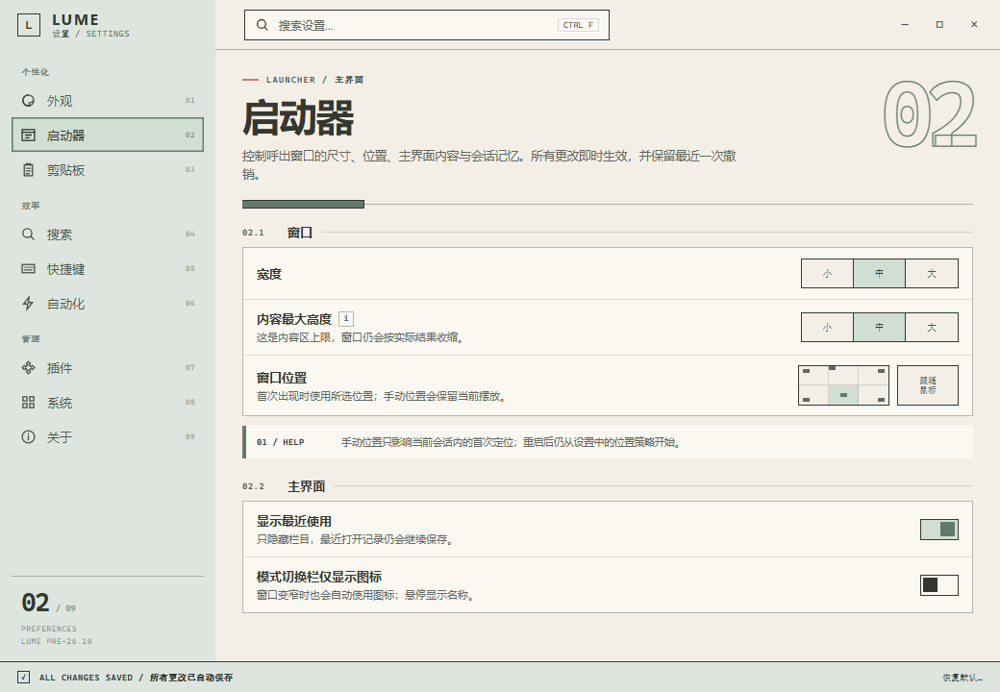
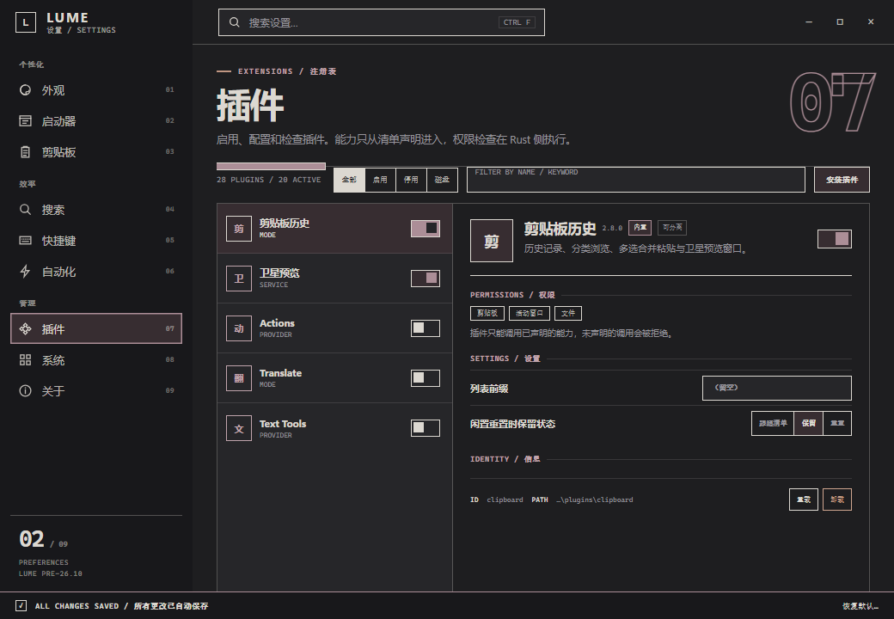

# Lume 设置面板重设计：Chromatic Edge 可选皮肤

适用范围：设置窗口（`src/settings/`、Tauri `settings` webview）。

本稿定义设置窗的 **Chromatic Edge** 可选皮肤，固定其浅色 Mineral 灰绿与深色
炭黑 / 浅粉灰玫瑰的最终色彩组合。默认皮肤是
[Quiet Control Deck](SETTINGS_REDESIGN.md)；两套皮肤通过
`appearance.settings_skin` 共存，运行时契约见
[设置窗皮肤切换](SETTINGS_SKIN_SWITCH.md)。

方案日期：2026-10-19。

## 文档关系

| 文档 | 直接职责 |
|---|---|
| [SETTINGS_SKIN_SWITCH.md](SETTINGS_SKIN_SWITCH.md) | 皮肤字段、首帧应用、默认值、保存回滚与切换验收；默认 `quiet` |
| [SETTINGS_REDESIGN.md](SETTINGS_REDESIGN.md) | Quiet Control Deck 默认皮肤，以及两套皮肤共享的信息架构、字段映射、自动保存、搜索和帮助语义 |
| 本文 | Chromatic Edge 可选皮肤；直角构图、编辑式页码、控件、页面与最终色板的完整视觉规范 |
| [SETTINGS.md](SETTINGS.md) | 当前功能契约；设计落地前仍以此处的字段语义和保存行为为准 |

实现时先读 `SETTINGS_REDESIGN.md` 的共享行为，再按本文实现 `chromatic` 皮肤，
并用 `SETTINGS_SKIN_SWITCH.md` 连接两套皮肤。

本文已吸收此前直角构图稿与色板变体稿的有效内容；变体文档不再单独维护。

## 视觉预览





静态预览可打开：

- `docs/assets/settings-redesign/chromatic-preview.html?palette=final&theme=paper&page=launcher`
- `docs/assets/settings-redesign/chromatic-preview.html?palette=final&theme=night&page=plugins`

## 设计意图

- **色彩成为结构**：浅色用灰绿、深色用灰玫瑰承担导航和选中结构，不做装饰性
  彩色斑点。
- **锐利但不拥挤**：直角、1.5px 结构线和明确留白制造秩序，不把“锐利”做成
  满屏黑框。
- **文字即图形**：大号页码、章节编号、等宽微标和标题共用同一套网格，标题与
  控件不是两套视觉元件。
- **整页先成立**：左侧色柱、页头、组线和状态条先组成一张完整画面，再嵌入设置
  控件。
- **低刺激**：大面积是米白或炭黑，选择面只做轻微明度差，风险色只做短线或小面积
  标记。

## 设计结论

### 皮肤定位

- `settings_skin = "quiet"` 是默认值，使用 Quiet Control Deck 的圆角卡片与
  双平面；共享行为、字段和自动保存契约见
  [SETTINGS_REDESIGN.md](SETTINGS_REDESIGN.md)。
- `settings_skin = "chromatic"` 使用本稿的直角面板、编辑式页码和灰绿 / 灰玫瑰
  色板。
- 每次渲染只启用一套皮肤；不能把 Quiet 的圆角、Chromatic 的直角和另一套
  色板拼在同一页面。
- 明暗模式与皮肤独立：Chromatic 的浅色 / 深色分别使用本稿的 Mineral Paper
  与 Charcoal Blush；Quiet 使用自己的浅色 / 深色色板。

### 浅色：Mineral Paper

- 主面是暖米白纸面 `#F3EFE6`。
- 左侧色柱、状态条使用低饱和灰绿 `#DDE5DE`。
- 当前项和选中面使用 `#D1DED4`，以轻微明度差和 1.5px 结构线确认状态。
- 结构线、焦点环和小字强调使用灰绿 `#64796D` / `#52675B`。
- 风险与警告使用低饱和陶土，不使用高饱和红。

浅色模式不追求“绿色品牌色”，而是让灰绿像纸张上的一个低音区：它占据导航和
状态条的空间，但不压过正文。用户扫视时先看到标题与设置内容，随后才感知到
色块的结构。

### 深色：Charcoal Blush

- 主面精确使用上传图片采样到的 `#1E1E20`。
- 左侧色柱和状态条使用更深的炭黑 `#18181B`。
- 面板、输入与浮层使用 `#262629`。
- 浅粉 / 灰玫瑰 `#AC8E97` 用于结构线、页码轮廓、焦点和图标。
- 选中面使用低亮度灰玫瑰 `#372D31`，文字使用温暖灰白 `#DCD8D1`。
- 风险提示使用灰陶土 `#C09682`，不使用亮红或荧光色。

深色模式不是把浅色主题反转，也不是在纯黑上叠加粉色。它以用户提供的炭黑为
主面，把浅粉控制在选中、页码和线条上，避免粉色成为大面积背景。

色块面积建议保持：主面约 80%，结构色约 13%，选中面约 5%，陶土信号不超过
2%。比例比具体色值更重要；某一色超过 10% 时会从结构变成背景。

## 最终色板

### 浅色

| Token | 值 | 使用位置 |
|---|---|---|
| `ce.base` | `#F3EFE6` | 主纸面 |
| `ce.base-2` | `#FBF8F1` | 面板、输入、浮层 |
| `ce.ink` | `#343832` | 主文字、结构线、图标 |
| `ce.ink-soft` | `#4E554F` | 次级文字 |
| `ce.muted` | `#626862` | 摘要与元信息 |
| `ce.line` | `rgba(52,56,50,.16)` | 行分隔线 |
| `ce.line-strong` | `rgba(52,56,50,.34)` | 面板与控件外框 |
| `ce.rail` | `#DDE5DE` | 左侧色柱、底栏 |
| `ce.rail-ink` | `#303A33` | 色柱上的文字与图标 |
| `ce.structure` | `#64796D` | 结构线、图标、焦点环 |
| `ce.structure-text` | `#52675B` | 章节编号与小字强调 |
| `ce.selected` | `#D1DED4` | 当前项、选中面、主操作底 |
| `ce.selected-ink` | `#303A33` | 选中面文字 |
| `ce.signal` | `#B88374` | 风险细线与状态点 |
| `ce.signal-text` | `#86594D` | 危险与错误文字 |
| `ce.success` | `#4D6D58` | 成功状态文字 |

### 深色

| Token | 值 | 使用位置 |
|---|---|---|
| `ce.base` | `#1E1E20` | 主炭黑面，来自用户图片 |
| `ce.base-2` | `#262629` | 面板、输入、浮层 |
| `ce.ink` | `#DCD8D1` | 主文字 |
| `ce.ink-soft` | `#BBB8B2` | 次级文字 |
| `ce.muted` | `#96949B` | 摘要与元信息 |
| `ce.line` | `rgba(220,216,209,.14)` | 行分隔线 |
| `ce.line-strong` | `rgba(220,216,209,.28)` | 面板与控件外框 |
| `ce.rail` | `#18181B` | 左侧色柱、底栏 |
| `ce.rail-ink` | `#DCD8D1` | 色柱上的文字与图标 |
| `ce.structure` | `#AC8E97` | 结构线、图标、焦点环 |
| `ce.structure-text` | `#C0A4AC` | 章节编号与小字强调 |
| `ce.selected` | `#372D31` | 当前项、选中面、主操作底 |
| `ce.selected-ink` | `#DCD8D1` | 选中面文字 |
| `ce.signal` | `#C09682` | 风险细线与状态点 |
| `ce.signal-text` | `#D0A68F` | 危险与错误文字 |
| `ce.success` | `#8DAE99` | 成功状态文字 |

## 对比度

| 前景 / 背景 | 对比度 | 用途 |
|---|---:|---|
| `#343832` / `#F3EFE6` | 10.41:1 | 浅色正文 |
| `#4E554F` / `#F3EFE6` | 6.69:1 | 浅色次级文字 |
| `#626862` / `#F3EFE6` | 4.98:1 | 浅色摘要 |
| `#52675B` / `#F3EFE6` | 5.30:1 | 浅色编号与强调 |
| `#303A33` / `#DDE5DE` | 9.18:1 | 浅色导航文字 |
| `#303A33` / `#D1DED4` | 8.60:1 | 浅色选中面文字 |
| `#86594D` / `#F3EFE6` | 5.16:1 | 浅色危险文字 |
| `#4D6D58` / `#F3EFE6` | 5.02:1 | 浅色成功文字 |
| `#DCD8D1` / `#1E1E20` | 11.72:1 | 深色正文 |
| `#BBB8B2` / `#1E1E20` | 8.41:1 | 深色次级文字 |
| `#96949B` / `#1E1E20` | 5.55:1 | 深色摘要 |
| `#C0A4AC` / `#1E1E20` | 7.25:1 | 深色编号与强调 |
| `#DCD8D1` / `#372D31` | 9.35:1 | 深色选中面文字 |
| `#D0A68F` / `#1E1E20` | 7.56:1 | 深色危险文字 |
| `#8DAE99` / `#1E1E20` | 6.85:1 | 深色成功文字 |

这里保留的是文字可读性所需的对比度；被压低的是大面积色块之间的彩度和亮差。
浅色主面、色柱和选中面之间的差距故意很小，深色主面、面板与选中面也不使用
刺眼的高亮阶跃。

## 组件落地色

| 组件 | 浅色 | 深色 |
|---|---|---|
| 左侧导航 | 灰绿色柱 + 浅灰绿当前项 | 炭黑色柱 + 灰玫瑰当前项 |
| 页面页码轮廓 | `#64796D` | `#AC8E97` |
| 组标题与章节编号 | `#52675B` | `#C0A4AC` |
| 主操作按钮 | `#D1DED4` 底 + 墨色字 | `#372D31` 底 + 米白字 |
| 次操作按钮 | 纸面底 + 墨线 | 炭黑面 + 浅线 |
| 方形开关开启 | 浅灰绿轨道 + 灰绿滑块 | 灰玫瑰轨道 + 米白滑块 |
| 分段选择选中 | `#D1DED4` + 墨色字 | `#372D31` + 米白字 |
| 滑块已选段 | `#64796D` | `#AC8E97` |
| 搜索焦点环 | `#64796D` | `#AC8E97` |
| 搜索选中结果 | `#D1DED4` | `#372D31` |
| 帮助带左边线 | `#64796D` | `#AC8E97` |
| 错误 / 警告 | `#B88374` 细线 + `#86594D` 文字 | `#C09682` 细线 + `#D0A68F` 文字 |
| 自动保存底栏 | 灰绿底 + 墨字 | 炭黑底 + 米白字 |

## 功能覆盖

| 页面 | Chromatic Edge 必须保留的字段 / 动作 |
|---|---|
| 外观 | `appearance.language`、`appearance.color_mode`、共享的 `appearance.settings_skin` |
| 启动器 | 窗口尺寸与位置、主界面开关、会话记忆、闲置重置、最近使用条数、占位符、条目大小与圆形图标 |
| 剪贴板 | 容量、记录类型、合并复制、忽略应用、显示方式、粘贴、预览与记住勾选 |
| 搜索 | `index.system_dirs`、`index.user_index`、缓存间隔、`refresh_index` |
| 快捷键 | `hotkeys.toggle`、`hotkeys.switch_mode`、两套校验路径与键盘速查 |
| 自动化 | 主开关、强制聚焦、提权代理、常驻代理、规则列表、规则测试与程序选择 |
| 插件 | 列表与筛选、启停、重载、安装、卸载、权限、声明式设置、闲置重置覆盖、开发者模式与全部授权 |
| 系统 | 开机启动、服务状态与动作、代理状态与动作、导入、导出、恢复备份、恢复默认 |
| 关于 | 版本、许可证、贡献者、主页与打开失败反馈 |

共享字段键、控件映射和保存语义以 [SETTINGS_REDESIGN.md](SETTINGS_REDESIGN.md)
为准；本稿只定义 `chromatic` 皮肤的视觉和版面，不引入第二条业务链路。

## 布局与视觉规范

### 视觉参考

| 参考 | 吸收的部分 | 不照搬的部分 |
|---|---|---|
| 瑞士国际主义平面设计 | 非对称网格、文字作为版面主体、强标题与细规则、有限色彩 | 不把界面做成静态海报，不牺牲控件识别 |
| Braun / Teenage Engineering | 工业色块、精确线宽、方形控件、有限功能色 | 不引入硬件式旋钮或过度仪表化 |
| Arc / Linear | 锐利的深色界面、明确选区、低装饰动画 | 不使用高饱和发光色、渐变球体和玻璃 |
| Windows 11 Settings | 任务分组、状态与动作分离 | 不沿用圆角卡片、柔和底色和 Fluent 轻描边 |
| WCAG 2.2 | 对比、焦点、命中目标、非颜色提示 | 不为“海报感”降低可读性 |

核心取舍是：**界面可以像一张图，但不能变成一张只能看的图**。

### 字体与网格

| 层级 | 字体 | 字号 / 行高 | 字重 | 处理 |
|---|---|---|---:|---|
| 页面标题 | Segoe UI Variable Display | 40 / 44 | 750 | 紧字距，允许负字距 |
| 页码 | Cascadia Mono | 96 / 96 | 700 | 空心描边，作为版面图形 |
| 页面说明 | Segoe UI Variable Text | 12.5 / 19 | 400 | 最大宽度 520px |
| 章节编号 | Cascadia Mono | 9 / 14 | 700 | 结构色，固定 38px 列宽 |
| 章节标题 | Segoe UI Variable Text | 13 / 18 | 700 | 与编号同基线 |
| 行标题 | Segoe UI Variable Text | 13 / 19 | 650 | 不用纯黑加粗堆叠 |
| 行摘要 | Segoe UI Variable Text | 11 / 16 | 400 | 次级灰 |
| 微标 | Cascadia Mono | 8.5–9 / 13 | 700 | 间距 0.6–1.1px，仅作结构 |
| 路径 / 快捷键 | Cascadia Mono | 9–10 / 16 | 500 | 等宽，支持复制 |

网格规则：

- 内容宽 760px，页头、章节标题、面板边界和状态条共用同一左边界。
- 章节编号固定占用 38px 列，标题列向右侧伸展，剩余空间是一条 1.5px 横线。
- 页面左侧留白 30px；标题、说明和面板左边缘严格对齐。
- 行内布局为“文字列 + 控件列”，控件右边缘对齐，不使用居中的标签。
- 竖线、横线、图标描边基础宽度统一为 1.5px；焦点可放大到 3px。
- 大号页码使用空心描边，不占用交互区域，也不进入阅读顺序。

所有英文或拉丁微标必须通过 `t()` 进入三语表，不能在组件里硬编码。预览中的
`LAUNCHER`、`PERMISSIONS` 等是构图占位；正式实现时可译为对应语言，或使用
编号、短横线和几何色块替代。

### 文字与图形融合

1. 标题、色条、章节编号和组线从左边界开始，形成连续视觉节奏。
2. 图标线宽与相邻正文的笔画密度匹配，不使用彩色圆形图标座。
3. 控件标签使用与行标题相同的基线和字重，不另起一套表单字体。
4. 大号页码与标题共用右侧留白，形成非对称平衡；页码不遮住文字和控件。
5. 色块一定有结构作用：导航、选择、确认、状态或分隔，不做纯装饰斑点。
6. 少用孤立小图标；一个图形要么与文字组成同一行，要么占完整的方格。

### 几何与表面

- 窗口内部的大面、面板、按钮、输入框、分段选择和开关使用 0–2px 圆角。
- Win11 外层窗口圆角由 DWM 负责，不能为了“锐利”去掉原生窗口轮廓。
- 层级由色面、1.5px 线框和留白决定，不用悬浮阴影；浮层可用 2px 外框和
  6px 硬阴影。
- 不允许嵌套超过两层的边框；行内列表使用分隔线，不创建第二层卡片。
- 一屏最多出现一个 96px 页码、一个 40px 标题和两组主面板。
- 页面顶部 26px、页头底部 21px、章节间距 20px；行高 54–58px；结构线
  1.5px。锐利来自边界和节奏，而不是把所有元素挤在一起。

### 窗口构图

```text
┌────────────────────────────────────────────────────────────────────────┐
│ 结构色柱 / LUME          [⌕ 搜索设置…       CTRL F]        ─  □  ×    │ 52
├───────────────┬────────────────────────────────────────────────────────┤
│ 个性化         │  LAUNCHER / 主界面                          02         │
│ 01 外观        │  启动器                                               │
│ 02 启动器      │  控制窗口尺寸、位置、主界面内容与会话记忆。            │
│ 03 剪贴板      │  ─────────────────────────────────────────────────    │
│                │  02.1  窗口                                             │
│ 效率           │  ┌───────────────────────────────────────────────────┐  │
│ 04 搜索        │  │ 宽度                         [小][中][大]          │  │
│ 05 快捷键      │  │ 内容最大高度                 [小][中][大]          │  │
│ 06 自动化      │  │ 窗口位置                     [位置网格]            │  │
│                │  └───────────────────────────────────────────────────┘  │
│ 管理           │                                                       │
│ 07 插件        │  02.2  主界面                                          │
│ 08 系统        │  ┌───────────────────────────────────────────────────┐  │
│ 09 关于        │  │ 显示最近使用                          [方形开关]    │  │
│                │  └───────────────────────────────────────────────────┘  │
│ 02 / 09        │                                                       │
├───────────────┴────────────────────────────────────────────────────────┤
│ ✓ 所有更改已自动保存                                        恢复默认… │ 32
└────────────────────────────────────────────────────────────────────────┘
```

#### 左侧色柱

- 宽 224px，从标题栏顶部贯穿到状态条上方；品牌区与导航导轨连成一个连续的
  结构色平面。
- 品牌区高 52px，包含方形 `L` 标记、`LUME` 字标和一行小号“设置”说明。
- 导航项高 36px，直角；当前项使用选中面和 1.5px 结构色内框，文字转为墨色或
  米白。
- 每项右侧显示 01–09 的等宽编号；未选项编号低对比，不抢标签。
- 组标签使用小号等宽字符；色柱底部显示 `02 / 09` 和大号页码，作为构图锚点。
- 不显示滚动条；导轨过长时滚轮滚动，当前项自动进入视野。

#### 标题栏

- 高 52px；左侧品牌平面直接使用当前皮肤的 `rail` 色。
- 搜索框为硬边矩形，1.5px 结构线，纸面 / 炭黑面底；右侧显示 `CTRL F` 微标。
- 窗口控制保持原生 Windows 顺序和命中面积，不使用多余装饰。
- 标题栏和内容之间使用 1.5px 分割线，左侧色柱跨过该线以保持连续。

#### 页头

- 顶部一行等宽小标由短陶土色线和当前页中英文短语组成。
- 页面标题 40px，紧字距，放在左侧；页面页码是右侧空心描边。
- 标题下方有一条 126px 结构色短条压在外框线上，作为“当前页”的色标。
- 页头不使用返回按钮；只有插件页在窄窗口的主从切换时提供返回。

#### 组与面板

- 组标题包含 `02.1` 编号、短标题和一条延伸至右边缘的细线。
- 面板为 1.5px 结构线矩形，内部行间用 1px 低对比线分隔。
- 面板不使用圆角、阴影或半透明底色。
- 复杂编辑器占满面板宽度，不额外创建第二层卡片。
- 说明、警告和空态使用带左侧 4px 色条的横带，而不是独立浮层。

#### 状态条

- 浅色主题：灰绿底、墨色等宽字。
- 深色主题：炭黑底、米白文字。
- 左侧显示方形勾选和“所有更改已自动保存”；右侧显示“恢复默认…”和当前页码。
- 错误时切换为陶土色细线 / 底色和明确文字，不能悄悄消失。

### 控件语言

#### 方形开关

- 轨道 40×22px，1.5px 结构线，直角；滑块为 15×15px 方形。
- 关闭：透明底、墨色滑块；开启：选中面底、结构色滑块。
- 命中盒至少 44×36px；使用 `role="switch"` 与 `aria-checked`。
- 状态不能只依赖填充颜色。

#### 分段选择

- 一整条 1.5px 外框，内部用 1.5px 竖线分隔。
- 选中段填充 `ce.selected`，文字使用 `ce.selected-ink`；未选中段为纸面 / 炭黑面。
- 选项段高 29px，最小宽 54px；2–4 项常驻，超过 4 项使用下拉矩形。
- 使用 radio group 或 `aria-pressed` 表达状态，方向键可切换。

#### 按钮

- 主按钮：浅色使用浅灰绿底墨色字，深色使用灰玫瑰底米白字。
- 次按钮：纸面 / 炭黑面底、1.5px 结构线、直角。
- 危险按钮：墨线或陶土线，文字使用危险色；不用大面积警示块。
- 悬停只改变填充或色线，不改变尺寸、不浮动。

#### 搜索框

- 硬边矩形，1.5px 墨线，纸面 / 炭黑面底；焦点显示 3px 结构色外环。
- 搜索浮层是硬边面板，2px 外框，结果行之间使用 1px 分隔线。
- 当前结果填充 `ce.selected`，文字保持高对比；不使用圆角高亮块。
- 输入使用 combobox / listbox 语义。

#### 输入框与滑块

- 输入框 30–34px 高，直角或 1px 圆角，1.5px 结构线。
- 聚焦时边框变为 2px 结构色；错误时边框变为陶土色，并显示行内错误。
- 滑块轨道为 2px 结构线，已选段使用结构色，滑块为 12×16px 方形。
- 数字值始终可见，单位以等宽小字贴右。

#### 快捷键录制

- 使用大号 keycap 方块；每个键帽 0–2px 圆角、1.5px 结构线、纸面 / 炭黑面底。
- 录制态填充选中面；Esc、失焦和点击外部取消，并显示原因。
- 组合之间用细竖线连接，例如 `ALT | SPACE`。

#### 帮助带

- 说明图标为 16×16px 方形 `i`，1px 结构线，与标签同一基线。
- 点击后在行下方展开“说明带”，左侧 4px 结构色竖条，内容按 76px 编号列对齐。
- 说明带不做浮层，避免遮挡控件，也便于键盘与读屏访问。
- 同一时间只展开一个说明带。

### 页面结构

#### 外观

- 页面页码 01；主题选择是三块 1.5px 外框色面样本，不使用圆角卡。
- “跟随系统”用纸面 / 夜色对角线拼接；选中态用结构色底线和方形角标。
- 语言使用整条硬边分段控件；设置窗皮肤行使用 Quiet / Chromatic 两项选择。

#### 启动器

- 页码 02，章节编号 02.1–02.4。
- 位置选择为 3×2 方格，选中格使用 `ce.selected`，中心用结构色小方块。
- 条目大小使用三个方块预览；窗口宽高使用硬边分段控件。
- 会话、搜索和闲置重置保持单列面板，不引入第二套卡片。

#### 剪贴板

- 页码 03，分为历史与采集、合并复制、忽略应用、显示与粘贴、预览五组。
- 合并复制关闭时滑块保留但低对比；忽略应用区域用 4px 陶土线标记隐私边界。
- 剪贴板页面停用提示使用结构色横带。

#### 搜索

- 页码 04；页面头右侧固定“立即刷新”方形按钮。
- 系统索引为三行表格式面板；用户索引使用名称、路径、索引文件、修复、删除
  的固定列宽网格。
- 刷新运行中，按钮填充选中面并显示方形旋转标记；错误在对应行下显示。

#### 快捷键

- 页码 05；两张大号 keycap 组合卡。
- 呼出键使用选中面，切换键使用纸面 / 炭黑面加结构线。
- 预设组合放在二级按钮排；键盘速查为硬边三列表格。

#### 自动化

- 页码 06；规则使用编号票券，每条有 1.5px 外框和左侧 4px 结构线。
- 折叠态显示“程序 + 新窗口焦点 → 延迟 + 快捷键”的自然语言摘要。
- 展开后显示程序、快捷键、延迟、测试、启用和删除，行间使用 1px 分隔线。

#### 插件

- 页码 07；左侧列表 274px，选中行使用 `ce.selected`；右侧详情为纸面 / 炭黑面。
- 详情顶部 50×50px 字母方块使用选中面，权限为硬边小方块。
- 设置项与详情标题共用 1.5px 分隔线；开发者选项放在详情底部折叠区。

#### 系统

- 页码 08；开机启动、系统服务、提权代理、数据与备份分组。
- 服务与代理使用状态票券；状态灯使用结构色、选中面、陶土色和空心方框，
  同时配文字。
- 数据与备份动作保持文字按钮和确认对话框。

#### 关于

- 页码 09；左侧大号 `LUME` 字标，右侧几何线构成品牌图形。
- 版本、许可证、贡献者和主页使用细线表格；主页为硬边主按钮。

### 搜索与状态

- 搜索浮层覆盖内容区上半部分，2px 外框；结果按标题、路径、当前值组织。
- 结果选中态使用 `ce.selected`；无结果使用陶土色说明带和三个建议词。
- 跳转使用滚动定位加 1.6 秒结构色描边，不切换整套色彩。
- 自动保存状态条使用等宽文字；保存中显示方形旋转标记，失败时使用陶土色顶线。
- 撤销按钮在状态条右侧出现，6 秒后隐藏；系统操作只在自己的状态票券内报告。

### 响应式

| 宽度 | 导航 | 内容 | 调整 |
|---:|---|---|---|
| ≥ 1000px | 224px 色柱 | 760px 居中 | 完整页码、双列状态票券、位置网格 |
| 760–999px | 196px 色柱 | 流式，左右 28px | 页码缩为 72px，插件列表 240px |
| 560–759px | 56px 图标栏 | 流式，左右 20px | 隐藏导航文字和页码，设置行上下排列 |
| < 520px 高 | 紧凑色柱 | 流式 | 压缩页头顶部间距，状态条保持可见 |

窄布局下：

- 左侧色柱保留结构色，只显示图标和当前项选中面；组标签隐藏。
- 页面标题降到 30px；大号页码隐藏，避免挤占控件。
- 位置网格缩为 3×2 小格，控件换行到标题下方。
- 插件页切换为“列表 → 详情 → 返回”，详情宽度占满。
- 状态条文案缩为“已保存”，错误时展开为完整句子。
- 面板仍保持直角，不为窄屏重新加圆角。

### 动效

- 页面切换：80ms 淡入 + 1px 下移，不使用滑动卡片。
- 选中态：60ms 直接换色，不做缩放。
- 帮助带：120ms 高度展开，不透明淡入。
- 状态条：颜色变化 120ms，不弹跳。
- 遵循 `prefers-reduced-motion`，关闭位移与过渡。

### 无障碍

- 所有正文组合达到 4.5:1；结构线、焦点和选中边界达到 3:1。
- 方形开关命中盒至少 44×36px，视觉形状不缩小点击区域。
- 焦点是 3px 硬边外框；纸面控件使用结构色，深色使用浅灰玫瑰或米白。
- 页码是纯视觉元素，应从读屏树隐藏；页面标题仍是唯一 `h1`。
- 等宽微标用于装饰时必须 `aria-hidden` 或有本地化可读文本。
- 选中、开启、错误、警告同时有文字或形状，不依赖单一颜色。
- 200% 缩放时标题可换行、页码可隐藏，控件不能重叠或被裁切。
- 搜索、帮助带、确认对话框和快捷键录制使用前案完整的键盘和焦点契约。

### 实现提示

Chromatic 皮肤可以由共享语义组件和限定作用域的 CSS 实现：

```text
src/settings/
  Settings.tsx
  skin.ts
  shell/
    SettingsShell.tsx
    SettingsTopBar.tsx
    SettingsNav.tsx
    SettingsPageHeader.tsx
    SettingsStatusBar.tsx
  components/
    SettingGroup.tsx
    SettingRow.tsx
    SegmentedControl.tsx
    HelpBand.tsx
    StatusTicket.tsx
  skins/
    base.css
    quiet.css
    chromatic.css
```

皮肤只承载 token、几何和装饰；页面数据和事件处理仍由同一组组件完成。切换
皮肤时不得重建页面树，否则焦点、滚动位置和本地编辑会丢失。

## 页面色彩应用

### 外观

- 浅色主题样本使用米白、灰绿与低饱和陶土三个色面；深色主题样本使用炭黑、
  面板灰与灰玫瑰三个色面。
- 语言选中项使用浅灰绿 / 深灰玫瑰底，不使用高亮描边。
- “跟随系统”样本用两条细线拼接，不使用渐变。

### 启动器

- 位置网格当前格使用浅灰绿 / 深灰玫瑰底，中心用灰绿 / 浅粉点标记。
- 宽度、高度、数字档位使用同一套分段控件，选中段只做轻微色面变化。
- 条目框大小使用三个低对比方块预览，选中块带结构线。

### 剪贴板

- 历史与采集面板保持纸面 / 炭黑面；记录开关使用方形开关。
- 忽略应用区域用陶土色 4px 左边线表达隐私边界。
- 合并窗口的禁用滑块保留可见，只降低对比度和可操作性。

### 搜索

- 索引目录和索引文件开关使用同一行结构。
- 刷新按钮在运行中切换为浅灰绿 / 深灰玫瑰底，并使用方形旋转标记。
- 无效目录错误显示在对应行下方，使用陶土色细线，不覆盖列表。

### 快捷键

- 呼出键与切换键使用大号方形 keycap。
- 录制态在浅色使用浅灰绿底，在深色使用深灰玫瑰底；取消后回到纸面 / 炭黑面。
- 预设组合放在二级按钮排，不与主 keycap 争夺注意力。

### 自动化

- 规则票券左侧使用结构灰绿 / 灰玫瑰竖线。
- 程序、快捷键、延迟展开后仍保持同一行网格。
- 重复规则与测试失败使用陶土说明带，成功状态保持低调。

### 插件

- 插件列表选中行使用浅灰绿 / 深灰玫瑰面，文字保持高可读对比。
- 详情字母方块使用同一选中色，不使用亮色或渐变图标座。
- 权限为硬边小方块；开发者选项只在展开后变更层级。

### 系统

- 服务、代理状态使用结构色状态灯和文字，不使用彩色整卡。
- 卸载、恢复、导入等动作使用文字按钮和确认对话框。
- 底栏自动保存状态条与导航色柱使用同一色族。

### 关于

- 大号 `LUME` 字标使用结构色轮廓。
- 版本、许可证、贡献者和主页保持细线表格布局。

## 设计约束

- 直角和 1.5px 结构线不变；不新增圆角卡片、阴影或渐变。
- 浅色不得把灰绿变成大面积高亮；深色不得把浅粉铺成大面积背景。
- 陶土色只用于风险、错误和隐私边界，不用于普通强调。
- 选中态必须同时有色面、边框或位置变化，不能只依赖颜色。
- 页面标题、页码、章节编号、面板左边界和底栏保持同一垂直对齐轴。
- 所有用户可见文字进入 `t()` 与三份语言文件；预览中的英文微标不作为正式
  硬编码文案。
- 业务逻辑继续留在 Rust；前端只 `invoke` 和渲染，不直接读写设置文件。
- 沿用前案的字段映射、自动保存 / 撤销、设置搜索、分层帮助和系统操作边界。

## 验收

- 浅色启动器页的主底色为 `#F3EFE6`，导航为 `#DDE5DE`，当前项为 `#D1DED4`，
  结构强调使用灰绿，风险提示使用低饱和陶土。
- 深色启动器 / 插件页的主底色为 `#1E1E20`，导航为 `#18181B`，选中面为
  `#372D31`，强调为低饱和灰玫瑰。
- 1040×720 与 560×420 下无横向溢出，页面标题、页码、控件和状态条保持对齐。
- 深浅主题的正文、次级文字、摘要、危险文字和成功文字达到 WCAG AA。
- 选中、错误、成功和禁用状态均可通过文字或形状辨认。
- 搜索可定位到具体设置行，帮助可展开并参与搜索。
- 服务、代理、导入、恢复、卸载等系统操作保留显式确认和真实结果。
- 1040×720 下左侧结构色平面贯穿标题栏到状态条；标题、组号、面板和状态条
  共用同一左轴。
- 一屏最多一个 96px 页码、一个主标题和两组主面板；没有漂浮卡片、阴影或
  彩色胶囊堆叠。

## 相关文档

- [设置窗皮肤切换实现契约](SETTINGS_SKIN_SWITCH.md)
- [Quiet Control Deck（默认皮肤与共享行为）](SETTINGS_REDESIGN.md)
- [当前设置功能契约](SETTINGS.md)

